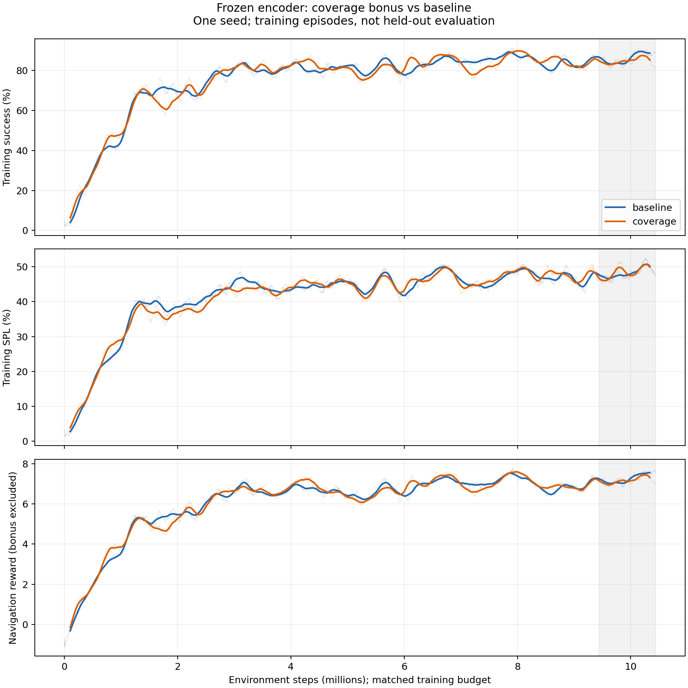

# Frozen encoder：固定 rollout 覆盖奖励实验

当前结论：**weight=0.1 尚未显示成功率收益。** 同步数的完整 Gibson val 结果略低；这是一个训练种子、一个模型时点的观察，不能据此判定长期必然有害。

## 同阶段完整验证

两份模型均训练至 **9,216,000 环境步**（各自 ckpt.17），每组完成全部 **4,200 条 Gibson val**。seed=100、PYTHONHASHSEED=0、6 个环境、每条最多 500 步；原生确定性动作和公共 safety 权重加载行为均保留，评估不启用 coverage。两份实际配置仅模型路径、输出路径及对应命令元数据不同。

| 指标 | 冻结基线 | 覆盖奖励 weight=0.1 | 覆盖组减基线 |
|---|---:|---:|---:|
| 成功率 | 78.36%（3291/4200） | 77.48%（3254/4200） | −0.88 个百分点，少成功37条 |
| SPL | 51.98% | 50.10% | −1.88 个百分点 |
| view_match | 76.64% | 75.08% | −1.56 个百分点 |

评估作业1498509、1498510均已完成且Exit_status=0。验证结果在2026-10-27约14:30 +08:00生成。[完整精度结果](evidence/comparison/full_val_comparison.json)、[配置审计](evidence/comparison/eval_config_audit.json)、[checkpoint冻结审计](evidence/comparison/checkpoint_integrity.json)、[模型步数／SHA](evidence/comparison/eval_manifest.json)。权重文件保留在服务器。

原生评估器只保存汇总，不保存逐episode成败；不能恢复成对结果或进行McNemar检验。未做多训练种子检验，也未完成300M训练。

## 最新训练曲线与观察沿革

下图快照时间 **2026-10-27T14:24:40+08:00**，基线23,646,208步、覆盖组10,438,656步；图中只比较共同前10,438,656步。最近100万步的原生训练滑动指标均值：

| 指标 | 基线 | 覆盖组 | 差值 |
|---|---:|---:|---:|
| 训练成功率 | 86.17% | 84.75% | −1.42 个百分点 |
| 训练SPL | 48.23% | 48.38% | +0.15 个百分点 |
| 导航reward | 7.270 | 7.174 | −0.097 |



[最新指标与区间统计](evidence/training/latest/training_comparison.json) · [PDF](evidence/training/latest/matched_training_curves.pdf) · [基线全部scalar CSV.gz](evidence/training/latest/baseline_scalars.csv.gz) · [覆盖组全部scalar CSV.gz](evidence/training/latest/coverage_scalars.csv.gz)

原生训练指标是50次update内已完成episode的滑动均值；图中粗线再用101点移动平均便于查看，表格使用原生值的区间均值。相邻点高度相关，不能视为独立样本。训练reward仍只记录环境导航奖励，不包含coverage bonus；训练指标也不等于验证集成功率。

13:40初次检查至共同9,488,384步时，最近100万步训练SR曾领先约0.78个百分点；更早区间亦有落后，整段训练SR曲线均值接近相等。14:24刷新后，领先关系反转。保留[初次快照](evidence/training/initial_1340/training_comparison.json)，不把早期小幅领先当成持续收益。

## 实验实现与固定设置

冻结基线代码dac8609；覆盖代码6983c91，仅改[src/metric.py](../../../src/metric.py)、[src/trainer.py](../../../src/trainer.py)、[新增YAML](../../../src/config/rollout_coverage.yaml)。两组均从公开checkpoint加载并冻结actor_critic.net.visual_encoder（42个状态项），其余模块按原初始化训练；保持原PPO/MRQ/RandomShift/Qc、seed100/hash0、8环境×256步、300M算法上限、个人项目A40／36CPU240GB／168h预算。两份9216000步模型encoder仍与公开权重逐位一致，参数全部有限。

覆盖是训练侧可行走区域的二维XZ视域并集代理，不输入Actor。初始视野只建立基线；重复观察不重复计数；episode重置清空，rollout边界不清空。mpp=0.10m、统计范围3m、FOV90°（匹配RGB）、weight=0.1。

每个固定rollout完成后、returns之前，各环境按真实episode边界独立分段，并在rollout末创建结算边界。每段只在末步加入 `bonus = weight * segment_new_area / H`，H=256；真实终止mask不变，不等待各环境同时结束。bonus独立记录在learner/coverage_*。

最新100万步平均bonus约0.130824/rollout，即每环境步约6.39e-5。信号量级较小只是待检验假设，尚未证明是当前未获益的原因。本轮没有调整权重或网络。

9项CPU边界测试和三组GPU短跑通过：初始／重复／重置、跨rollout、多episode结算位置、bonus总量、mask不变及weight0奖励不变；三组各40960步，42项encoder状态不变。[单测](evidence/validation/unit_tests.log)、[GPU短跑](evidence/validation/short_summary.json)、[朝向／遮挡代理检查](evidence/validation/scene_probe.json)。原同节点统计对照每步额外耗时约30.3%；长跑到相同9.216M步耗时基线20710s、覆盖26390s（+27.4%，不同节点，不作为纯统计开销隔离对照）。

## 运行状态、复现与来源

发布前核查时间及控制台步数见[运行状态快照](evidence/comparison/publication_runtime_status.json)：1496716、1497416均R；未停止、重启或更改两组训练。后续进展会超过本资料包的固定快照。

[基线训练PBS](scripts/baseline/train_personal.pbs) · [覆盖训练PBS](scripts/coverage/train_personal.pbs) · [基线评估PBS](scripts/comparison/baseline.pbs) · [覆盖评估PBS](scripts/comparison/coverage.pbs) · [评估程序](scripts/comparison/evaluate_checkpoint.py) · [训练曲线导出器](scripts/comparison/analyze_training.py) · [验证汇总器](scripts/comparison/summarize_eval.py)

本轮实际已执行命令为 `qsub baseline.pbs`／`qsub coverage.pbs`（作业ID见上），经由辅助程序调用原生run_sim.py。复现评估的命令形状如下；路径为示意，使用新的输出目录：

```bash
PYTHONHASHSEED=0 OMP_NUM_THREADS=1 MKL_NUM_THREADS=1 OPENBLAS_NUM_THREADS=1 \
python run_sim.py --exp-config exp_config/ppo_imagenav_gibson.yaml,policy,reward,sensors,eval \
  --run-type eval --model-dir results/your_fresh_eval_directory \
  habitat_baselines.eval_ckpt_path_dir /path/to/the_same_step_checkpoint.pth
```

PBS及辅助脚本保留已执行版本中的服务器绝对路径，移到其他机器需重设路径，并自行准备Habitat环境、授权场景、任务数据和公开权重；不会自动下载数据或自动启动新实验。两组[实际训练与评估配置](evidence/config/)均已保存。全量训练指标以gzip发布，解压后的SHA记录在[发布清单](publication_manifest.json)。压缩的原生评估控制台日志和原始评估TensorBoard事件也在evidence/comparison/。

[工作区状态](workspace/STATUS.md) · [操作日志](workspace/WORKLOG.md) · [运行手册](workspace/RUNBOOK.md) · [稳定规则](workspace/AGENTS.md)。四文档是liuyi根维护源的自动生成快照，文中服务器路径用于定位未公开资源；发布副本WORKLOG保持追加关系。

本包不含checkpoint、场景、Python环境或原始相机数据；既有第一阶段Qwen资料不在本轮重建。运行时代码仍分别是dac8609和6983c91，本次发布只增加资料及导航。
