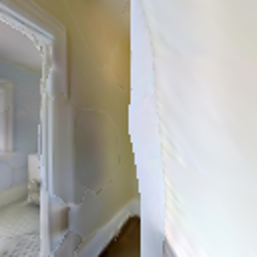
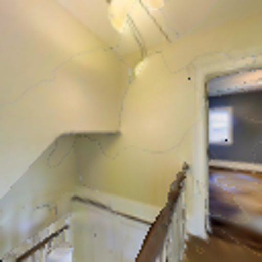
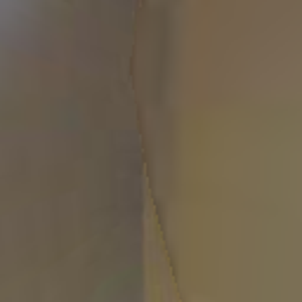
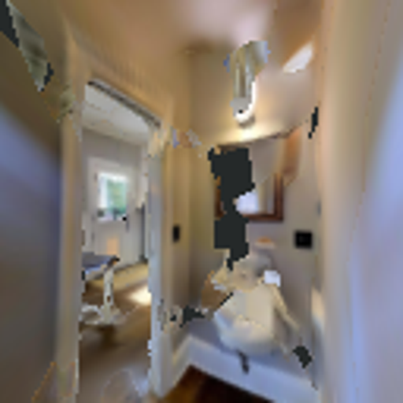
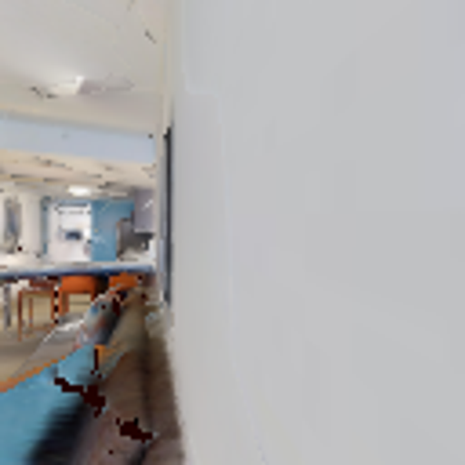
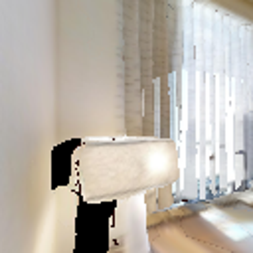
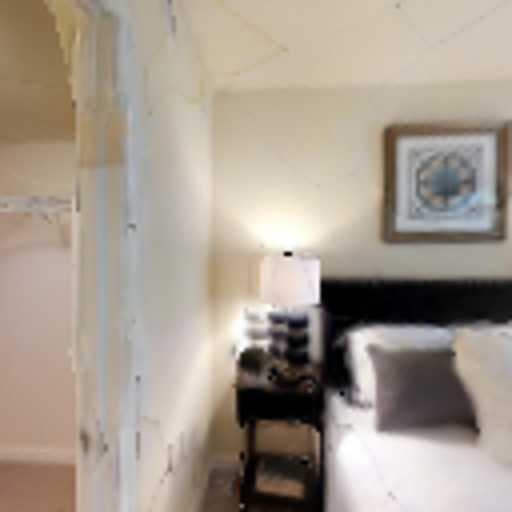
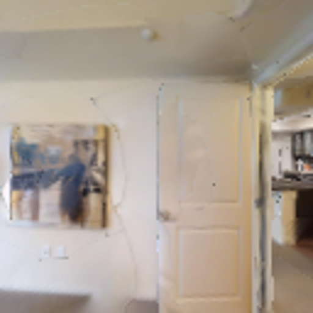
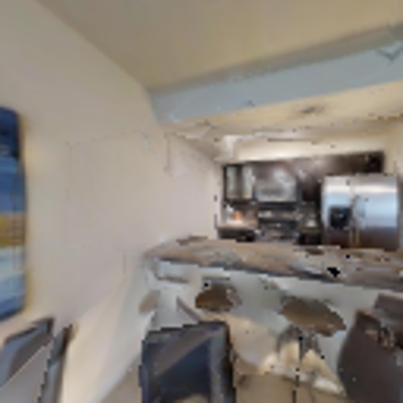
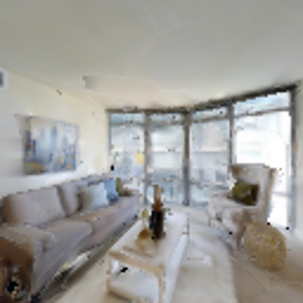

# 全量成败变化案例与审计

全部8条SR变化都列出；人工原因/备注保持空白，自动前缀审计不是人工根因标签。仅5条有前缀支持的真实模型改向提供候选图；其他3条属于无本episode模型改向的变化。16份NPZ只含commands和poses，供事后核对，不是Agent输入。

|场景/任务|规则→Qwen成功|首次动作差异步|模型改向步|决定前前缀一致|
|---|---|---:|---|---|
|Elmira/2824|1→0|121|[121]|True|
|Mosquito/3479|0→1|0|[]|False|
|Scioto/2174|0→1|36|[]|False|
|Scioto/2230|0→1|122|[122]|True|
|Scioto/2314|1→0|120|[120]|True|
|Swormville/3026|0→1|0|[]|False|
|Swormville/3040|0→1|143|[143]|True|
|Swormville/3290|1→0|58|[58]|True|

以下5条以成败改变和真实前缀为条件全部纳入，既含2条救回也含3条误伤，没有只挑成功图。输入图/完整正反概率/logits及模型回退信息见[原始事件](evidence/logs/qwen_recovery_iteration_20261108/expanded_v2/expanded03_full/full_qwen/native/recovery/events.jsonl)。

## Scioto / 2314

|左：实际Qwen输入|右：实际Qwen输入|
|---|---|
|||

[目标图：仅供人审，当前Qwen没有接收它](evidence/logs/qwen_recovery_iteration_20261108/expanded_v2/expanded03_full/full_qwen/native/recovery/inputs/event_0000009.goal.png)。模型只接收上面左右RGB，各自独立对话；没有GT地图/距离/碰撞输入。

决定步120，默认规则A，实际模型选择B（A左/B右）。

|候选方向|正问开放支持|反问开放支持|
|---|---:|---:|
|left|0.255047|0.516000|
|right|0.380020|0.610811|

支持是三词条件概率的组合，不是导航成功概率。原始轨迹留服务器；本包包含上述8个任务的规则/Qwen commands+poses NPZ，可独立重算首次动作分歧及前缀。

## Scioto / 2230

|左：实际Qwen输入|右：实际Qwen输入|
|---|---|
|||

[目标图：仅供人审，当前Qwen没有接收它](evidence/logs/qwen_recovery_iteration_20261108/expanded_v2/expanded03_full/full_qwen/native/recovery/inputs/event_0000016.goal.png)。模型只接收上面左右RGB，各自独立对话；没有GT地图/距离/碰撞输入。

决定步122，默认规则A，实际模型选择B（A左/B右）。

|候选方向|正问开放支持|反问开放支持|
|---|---:|---:|
|left|0.242720|0.376028|
|right|0.407219|0.543577|

支持是三词条件概率的组合，不是导航成功概率。原始轨迹留服务器；本包包含上述8个任务的规则/Qwen commands+poses NPZ，可独立重算首次动作分歧及前缀。

## Elmira / 2824

|左：实际Qwen输入|右：实际Qwen输入|
|---|---|
|||

[目标图：仅供人审，当前Qwen没有接收它](evidence/logs/qwen_recovery_iteration_20261108/expanded_v2/expanded03_full/full_qwen/native/recovery/inputs/event_0000102.goal.png)。模型只接收上面左右RGB，各自独立对话；没有GT地图/距离/碰撞输入。

决定步121，默认规则A，实际模型选择B（A左/B右）。

|候选方向|正问开放支持|反问开放支持|
|---|---:|---:|
|left|0.105152|0.448829|
|right|0.269166|0.732401|

支持是三词条件概率的组合，不是导航成功概率。原始轨迹留服务器；本包包含上述8个任务的规则/Qwen commands+poses NPZ，可独立重算首次动作分歧及前缀。

## Swormville / 3040

|左：实际Qwen输入|右：实际Qwen输入|
|---|---|
|||

[目标图：仅供人审，当前Qwen没有接收它](evidence/logs/qwen_recovery_iteration_20261108/expanded_v2/expanded03_full/full_qwen/native/recovery/inputs/event_0000121.goal.png)。模型只接收上面左右RGB，各自独立对话；没有GT地图/距离/碰撞输入。

决定步143，默认规则A，实际模型选择B（A左/B右）。

|候选方向|正问开放支持|反问开放支持|
|---|---:|---:|
|left|0.274139|0.466035|
|right|0.476699|0.671386|

支持是三词条件概率的组合，不是导航成功概率。原始轨迹留服务器；本包包含上述8个任务的规则/Qwen commands+poses NPZ，可独立重算首次动作分歧及前缀。

## Swormville / 3290

|左：实际Qwen输入|右：实际Qwen输入|
|---|---|
|||

[目标图：仅供人审，当前Qwen没有接收它](evidence/logs/qwen_recovery_iteration_20261108/expanded_v2/expanded03_full/full_qwen/native/recovery/inputs/event_0000131.goal.png)。模型只接收上面左右RGB，各自独立对话；没有GT地图/距离/碰撞输入。

决定步58，默认规则A，实际模型选择B（A左/B右）。

|候选方向|正问开放支持|反问开放支持|
|---|---:|---:|
|left|0.458535|0.531834|
|right|0.654110|0.764521|

支持是三词条件概率的组合，不是导航成功概率。原始轨迹留服务器；本包包含上述8个任务的规则/Qwen commands+poses NPZ，可独立重算首次动作分歧及前缀。
