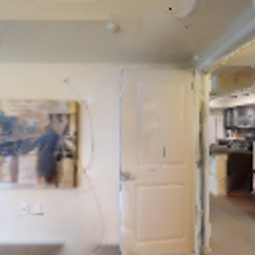
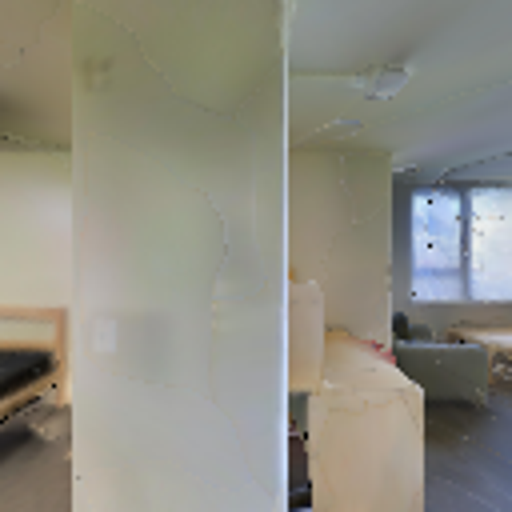
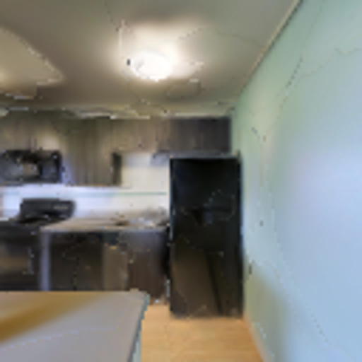

# SIGN现状与Qwen框架讨论：完整验证已完成

资料截面：2026-11-08T14:16:24+08:00。行为固定提交`f0e093c4d52c595c71f109d69cbf67ae7fbe3daa`；资料提交可以继续前进，运行快照保持不变。

[逐轮机器可读结果](results.json) · [文件SHA与服务器来源](inputs.json) · [当前STATUS生成副本](workspace/STATUS.md) · [追加式操作记录](workspace/WORKLOG.md)

[全部项目分支与工作树](BRANCHES.md) · [8条成败变化、实际输入与动作前缀](CASES.md)

**本轮只更新文档和证据，等待与用户进一步沟通；不修改恢复算法，不提交新PBS实验。** 用户更重视Qwen承担恢复决策，同观测/动作/步数预算下达到规则效果也有价值。后续可在讨论明确后并行多组对照，但当前占用少不等于已核实项目GPU-hour余额；提交前仍需核对项目许可/余额/队列约束。

## 已完成完整验证与贡献边界

所有方法使用同一个125.952M覆盖256导航checkpoint。正式1532001和CPU1532002均Exit0，GPU用时2:17:44；三组各4200任务，原生4200位姿SHA完全复现参考。

|方法|成功条数|SR|SPL|平均碰撞|平均步数|
|---|---:|---:|---:|---:|---:|
|覆盖256原策略|3678|87.5714%|53.2996%|36.679|113.559|
|旧无扫描规则|3708|88.2857%|53.6766%|32.969|110.464|
|本轮匹配扫描规则|3721|88.5952%|53.7751%|30.798|109.451|
|本轮Qwen2B混合恢复|3723|88.6429%|53.7772%|30.704|109.279|

Qwen相对匹配规则描述性净多2/4200（SR+0.047619pp、SPL+0.002150pp）。但5救回/3误伤中，真实模型改向且决定前动作/位姿一致的只有**2救回、3误伤**；另3救回在该episode没有模型改向。并行batch/episode结束影响只是机制假设，尚未重放验证。原producer门True和full_completed回执原样保留；这个汇总门未扣除无改向救回，不能据True称稳定VLM收益。人工标签全部留空。[独立复核](evidence/logs/qwen_recovery_iteration_20261108/expanded_v2/expanded03_full/completed_review_20261108.json)。

## 当前逻辑与尚待讨论的问题

当前正常动作由SIGN生成；16步窗口75%有前进意图且旋转补偿后RGB低变化时触发；24步扫描获得左右90度图，再选方向。规则第一次左、第二次右；Qwen在左右图上独立问通行/障碍，双问支持差>=.05同向才改默认，两问默认open最高则保持默认，证据不足回退规则。随后计划6步转向+8步前进（指令1.6m）再交回SIGN，冷却64步；每episode最多2次/76覆盖步，全部计入500，原STOP/masks/GRU保持。

当前151次完成评分中98次回退规则，53次采纳模型但仅23次真正改变规则方向。因此88.64%是混合框架成绩，尚不能证明Qwen独立承担决策也能同效。实际Qwen输入是左右相机RGB；目标图只给SIGN和人审，没有给当前Qwen，也没有完整历史。语义版selector总会返回左或右，Qwen不能选择本次不恢复；恢复后的RGB变化只记录，不用于验收/撤销/记忆失败方向。这些限制由现有代码可直接核查。

待沟通后再确定：①成功标准是独立VLM替代达到同效，还是混合系统追求增益；②给目标/近期观察/动作反馈的最小输入，以及图像布局偏置检查（旧整组拼图曾失败，不能原样复用）；③是否让Qwen选择左/右/继续SIGN，规则回退作为单独消融；④如何用实际可得视觉反馈核验恢复、记录失败方向，同时保持原预算；⑤同预算多方案并行和未用留出集如何预先固定。以上均为讨论题，**没有实现或排队**。

## 最新辅助reward训练

此处是此前奖励训练，推理恢复使用固定模型。训练快照2026-11-08T13:56:28+08:00，最近1M内原生50-update滑窗日志均值；不同步数不直接排名，不是val，日志末步不等于checkpoint步数。

|方法|日志百万步|近1M SR|近1M SPL|状态|
|---|---:|---:|---:|---|
|冻结视觉基线|74.654|87.87%|54.82%|用户停止|
|覆盖256|172.599|87.80%|50.60%|原PBS时限结束|
|覆盖32|175.868|88.76%|51.37%|原PBS时限结束|
|Qwen128 beta0.1|32.829|87.25%|49.21%|原PBS时限结束|
|A Qwen128 beta0.03|41.552|85.03%|48.14%|原PBS时限结束|
|B Qwen256 beta0.03|38.439|87.94%|49.21%|运行|
|几何128|82.196|88.64%|51.41%|用户暂停|

当前只有B1511148运行，原预算约余17.36h。B相同38.438912M的近3M比较如下；最新1M SR相对前1M仍-0.42pp。13:02旧快照中B为86.47/48.25%，当前有所恢复，两个快照同时保留，不把短窗起伏当稳定提升。

|同预算近3M|SR|SPL|
|---|---:|---:|
|冻结基线|86.2498%|51.2080%|
|覆盖256|84.8372%|47.5284%|
|覆盖32|85.1557%|46.8539%|
|Qwen256 beta0.03|87.9256%|50.5966%|

B两项高于同期两覆盖；对基线仍是SR更高、SPL更低。原训练与续跑优化器/reset历史不同，单种子和重叠训练窗不能作严格因果或val收益结论。完整1/2/3M正负窗口、CORE原数值近期CSV及原文件SHA在本包，完整TB与大日志保留服务器。

## 方法与控制

导航模型使用覆盖256的125,952,000步checkpoint；不重新训练，不把Qwen接入PPO奖励。原SIGN继续决策，只有RGB与实际动作历史出现持续受阻迹象时才触发。24个实际原地转向动作获取左右90度RGB；两张图独立输入Qwen3.5-2B，FP32/T=1，读取No/Unknown/Yes真实答案token logits。正问通行性与反问障碍物须同向支持，默认侧在两问中都判可通行时保持规则；其余证据不足回退匹配规则。最多两次恢复，每次90度转向及1.6m短尝试；连扫描最多76个覆盖动作都计入原500步，原STOP/masks/GRU保留。

比较原生off、同扫描/同动作/同触发器的rule，以及qwen。回退到规则和主动扫描的收益不能算作模型判断的额外贡献。Agent不读取GT pose、collision、distance或地图；这些仅供离线选题和事后前缀审计。

三候选softmax只是条件词概率，不是校准的通行或导航成功率；正反问来自同一模型，不按独立事件相乘。VLM职责限于局部受阻方向选择，不承担全局目标规划。

既有完整4200参考：off SR/SPL 87.5714%/53.2996%，旧不扫描规则 88.2857%/53.6766%。旧规则与本轮主动扫描规则的动作预算不同，本轮已重跑匹配rule；两种规则分别报告。

## 全部迭代

初始e9e5c0f/1531403三组各280任务，四事件全回退规则，Qwen与匹配规则280条原始行/动作哈希全等，没有额外模型作用。后续改用真实No/Unknown/Yes词读出、独立RGB和开发迭代；这个零收益版本及其完整复核也保留在evidence中。

原24条开发诊断后，预先登记加入全部额外37条，合61条；扩展诊断改用单环境减少别的episode结束引起的组批干扰。正式4200仍原6环境，不混比不同N和不同任务集的绝对成绩。下表含负结果和看似正向却无因果支持的版本；同一开发数据被反复用于调试，不能当独立测试。

N1与原N6并非逐轨迹相等：34条原生审计最大首动作差0.0015053、只有4条完整位姿哈希相等；具体底层数值来源未因果确定。61条虽然按旧N6失败诊断选择，新N1原生实际成功13条，所以本轮原生、规则、Qwen都重新配对跑，不把旧失败标签当本轮真实失败；小诊断也不替代原6环境正式协议。

|轮次/分组|N|规则成功|Qwen成功|净变化|前缀支持救回|误伤|规则SPL|Qwen SPL|
|---|---:|---:|---:|---:|---:|---:|---:|---:|
|round01/develop|24|6|6|+0|0|0|11.5487%|11.5487%|
|round02/develop|24|9|9|+0|0|0|16.7676%|16.1673%|
|round04/develop|24|9|9|+0|0|0|16.7676%|16.1673%|
|round05/develop|24|9|9|+0|0|1|16.8963%|15.0733%|
|round06/develop|24|9|10|+1|0|0|14.9793%|16.7851%|
|expanded01/develop|61|30|27|-3|1|4|19.3042%|16.3133%|
|expanded03/develop|61|30|31|+1|1|0|19.3042%|19.4396%|
|expanded03/safety|28|27|27|+0|0|0|49.1671%|49.1671%|
|expanded03_repeat/develop|61|30|31|+1|1|0|19.3042%|19.4396%|
|expanded03_repeat/safety|28|27|27|+0|0|0|49.1671%|49.1671%|
|expanded03_confirmation/confirm|24|9|9|+0|0|0|16.2611%|14.9766%|
|expanded03_confirmation/general|112|103|103|+0|0|0|55.6575%|55.6575%|
|expanded03_confirmation/safety|28|27|27|+0|0|0|49.1671%|49.1671%|
|expanded03_full/full|4200|3721|3723|+2|2|3|53.7751%|53.7772%|

round03在真实空白输入对照中暴露位置偏好，技术门失败，未跑导航。round06表面多1成功但没有模型改向/前缀支持，被拒绝。expanded01真实1救回4误伤，净-3，未放行；之后仅在开发上调整双问一致性和保留可通行默认。另5条已知案例短回归是事后选择的集成调试，不能另算5个独立样本。

## 固定版收益与边界

首次完整61开发：规则30/61→Qwen31/61，SPL19.3042%→19.4396%，1救回/0误伤。35事件中只有2条轨迹真正偏离规则；59条无偏离轨迹的所有原始字段与动作/位姿哈希精确相等。Swormville3040在模型决定前前缀一致，90步改向后123步成功，规则500步失败；Ribera1167仍成功但SPL68.3569%→54.6825%，效率代价保留。安全28均27成功且0触发，因此只验证未触发回归。人工原因列留空，AI描述不是人工真值；1个救回也不构成统计显著性。

### 开发中真实改向：Swormville / 3040

|左侧实际模型输入|右侧实际模型输入|
|---|---|
|||

图中没有GT标注，左右图分别独立送模型；人工原因未填写。两问原始概率/logits和实际回退规则见对应events.jsonl。

### 开发中真实改向：Ribera / 1167

|左侧实际模型输入|右侧实际模型输入|
|---|---|
|||

图中没有GT标注，左右图分别独立送模型；人工原因未填写。两问原始概率/logits和实际回退规则见对应events.jsonl。

开发与同版重复都须净成功>=1且至少1前缀支持救回。确认24、普通112和安全28用冻结版本检查；预登记版本2允许确认中性且其他组成功数不降时进入正式4200进一步检验，不把中性确认称独立优势，也没有承诺SPL不降。原旧门/False/dispatch不覆写，必要时另留版本2审计；确认成功数下降则不放行。完整val复用了开发选择来自的benchmark，不宣称完全未接触测试。

冻结确认24：规则9/24、Qwen9/24；SPL16.2611%→14.9766%。成功数持平时明确称中性，SPL下降也保留；不以开发上的救回掩盖保留集尚无额外收益。

正式4200作业：**1532001.stdct-mgmt-02**，固定`f0e093c4d52c595c71f109d69cbf67ae7fbe3daa`，三个对照各4200/14场景/6环境/max500/seed100/hash0；已完成，完整结果见results.json。

## 复现与审计

行为配置：[inference_semantic_consensus_veto90.yaml](../../../../src/config/inference_semantic_consensus_veto90.yaml)；提示：[通行性](../../../../scripts/prompts/recovery_semantic_forward.txt)、[障碍物](../../../../scripts/prompts/recovery_semantic_obstacle.txt)。各batch的submission/tasks/source_manifest记录完整命令、资源、checkpoint SHA与不可变源文件，配对CSV保留空白人工标签。events.jsonl保留所有事件的模型输入SHA/原始正反logits/概率/回退原因；图像摘录开发改向和完整验证中5条有前缀支持的成败变化，另外8个成败变化任务的16份commands/poses NPZ一起保留；完整相机序列/模型/场景留服务器。

资料生成器只读取证据，不提交作业。离线核验：在克隆根运行`python docs/experiments/inference-recovery/iteration_20261108/evidence/logs/qwen_recovery_iteration_20261108/publish_iteration.py --check-only --tree .`；按inputs.json逐项复算SHA，不加载模型。实际导航依赖服务器RUNBOOK所列环境与合法数据。代码单元回归74项、旧Qwen14项通过；实际FP32词ID2665/13394/9175、真实答案位置、批单和空白/换序检查均保留原证据。
