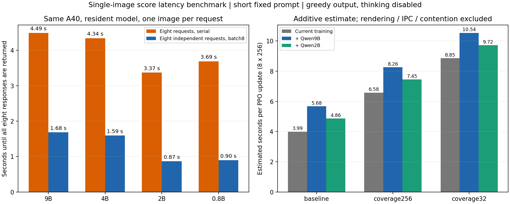

# 速度记录：生成式JSON与真实logits分开

以下旧测速使用单图JSON数字回答，短prompt，BF16/auto，模型常驻。同一A40上测1图、8独立请求batch8与串行；不是把8张图放进一个会话。每模型52次输出包含重复测速，不是52个独立质量样本。

| 模型 | 单图秒 | 独立batch8整批秒 | 串行8图秒 | 峰值GiB | 严格JSON通过 |
|---|---:|---:|---:|---:|---:|
| Qwen3.5-9B | 0.529 | 1.682 | 4.491 | 18.93 | 52/52 |
| Qwen3.5-4B | 0.533 | 1.593 | 4.341 | 9.82 | 35/52 |
| Qwen3.5-2B | 0.402 | 0.869 | 3.368 | 4.79 | 52/52 |
| Qwen3.5-0.8B | 0.458 | 0.896 | 3.690 | 2.23 | 0/52 |

当前ABC概率评分使用FP32前向，不生成JSON数字。它的实际批次秒数如下（包含预处理/读出审计，不能与旧BF16生成式耗时混为同一工作负载）：

| 评分批次 | 每批8图秒 |
|---|---|
| 9B pilot | 5.280 / 5.308 |
| 2B pilot | 1.819 / 1.683 |
| 2B diverse | 1.670 / 1.672 |

[完整测速JSON](../evidence/latency/comparison.json) · [任意测速prompt](../prompts/latency_json.txt) · [实测训练每轮时间](../evidence/latency/training_timing.json)

旧训练最近500轮均值约3.99/6.58/8.85秒（冻结基线/coverage256/coverage32）；每轮8×256环境动作。同步相加仅为成本估计，未测在线绘图、IPC及同GPU争用，不能把旧测速估计当成新FP32评分的端到端训练实测。
