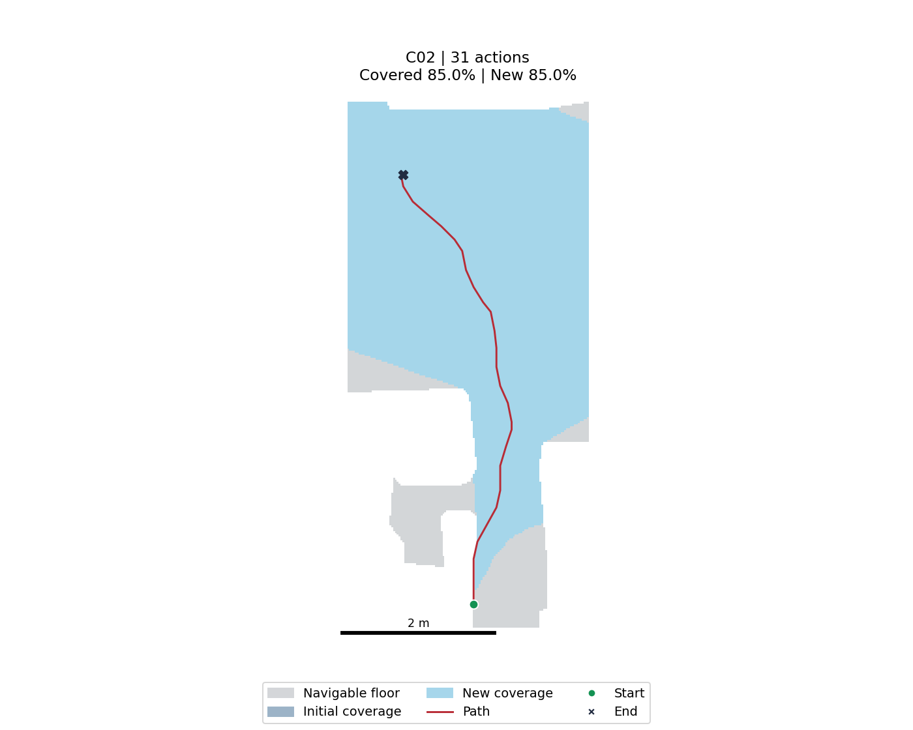
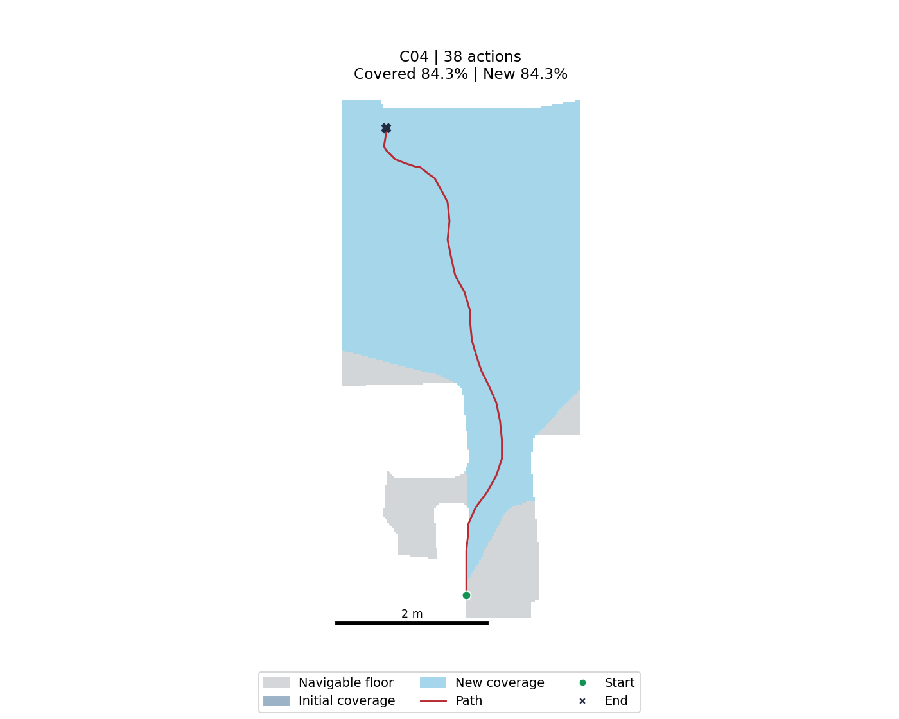
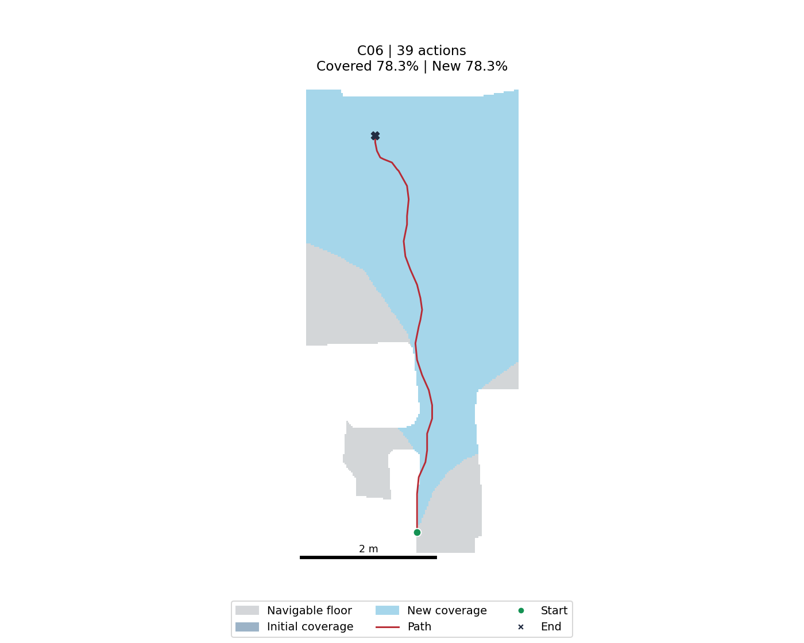
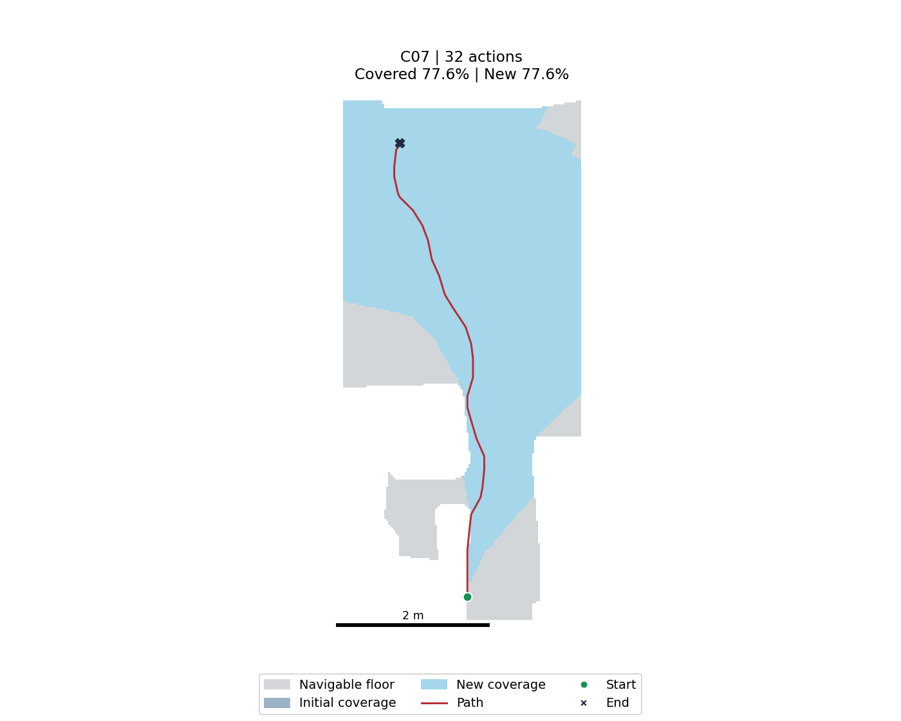
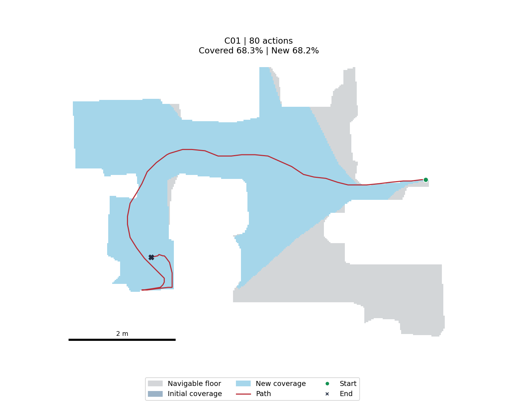
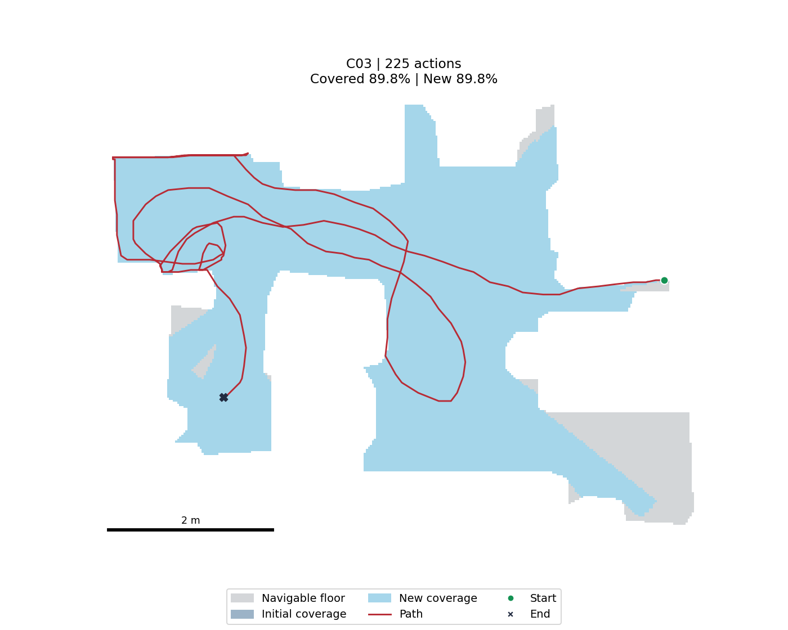
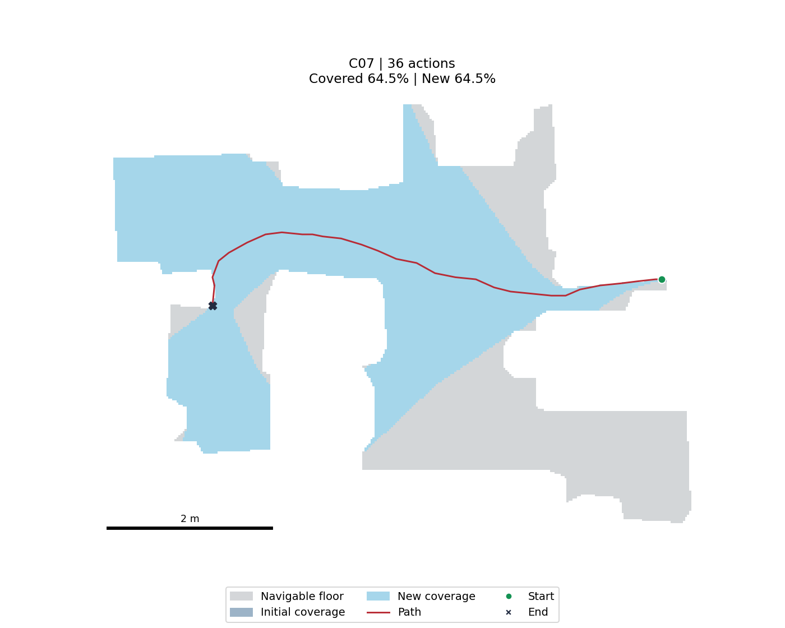
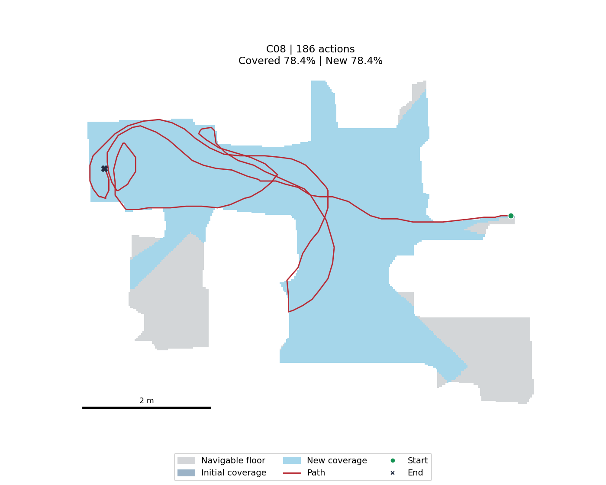

# Gibson同图：9B与2B独立概率评分

两组各8条同任务重复轨迹。每张图独立评价，batch行间不共享图片或对话；相同prompt、metadata、图片SHA，FP32，T=1。q=0.5×P(MEDIUM)+P(HIGH)。不是相对排名。

[原始9B CSV](../evidence/probability/pilot_9b/scores.csv) · [原始2B CSV](../evidence/probability/pilot_2b/scores.csv) · [Prompt](../prompts/coverage_abc_v1.txt)

| 图片（点击放大） | 场景/任务 | 动作 | 新增m²/动作 | 9B LOW/MED/HIGH | 9B q | 2B LOW/MED/HIGH | 2B q |
|---|---|---:|---:|---|---:|---|---:|
|  | Edgemere / 200 / C01 | 35 | 0.3649 | 0.1587/0.3774/0.4639 | 0.6526 | 0.0906/0.1845/0.7249 | 0.8171 |
|  | Edgemere / 200 / C02 | 31 | 0.4352 | 0.1365/0.3473/0.5162 | 0.6899 | 0.0786/0.1503/0.7710 | 0.8462 |
|  | Edgemere / 200 / C03 | 34 | 0.3829 | 0.1607/0.3702/0.4690 | 0.6542 | 0.1282/0.2129/0.6589 | 0.7654 |
|  | Edgemere / 200 / C04 | 38 | 0.3523 | 0.1843/0.4184/0.3974 | 0.6065 | 0.0823/0.1531/0.7646 | 0.8411 |
|  | Edgemere / 200 / C05 | 33 | 0.4091 | 0.1385/0.3489/0.5127 | 0.6871 | 0.0919/0.1661/0.7421 | 0.8251 |
|  | Edgemere / 200 / C06 | 39 | 0.3187 | 0.1628/0.3518/0.4854 | 0.6613 | 0.1239/0.2193/0.6568 | 0.7665 |
|  | Edgemere / 200 / C07 | 32 | 0.3850 | 0.1682/0.3508/0.4810 | 0.6564 | 0.1575/0.2127/0.6298 | 0.7362 |
|  | Edgemere / 200 / C08 | 36 | 0.3713 | 0.1138/0.3182/0.5680 | 0.7271 | 0.0927/0.1871/0.7202 | 0.8138 |
|  | Denmark / 3800 / C01 | 80 | 0.1418 | 0.4715/0.3353/0.1931 | 0.3608 | 0.1114/0.1578/0.7309 | 0.8098 |
|  | Denmark / 3800 / C02 | 69 | 0.1599 | 0.3763/0.3929/0.2308 | 0.4273 | 0.0786/0.1599/0.7614 | 0.8414 |
|  | Denmark / 3800 / C03 | 225 | 0.0663 | 0.5041/0.3038/0.1921 | 0.3440 | 0.2484/0.2570/0.4946 | 0.6231 |
|  | Denmark / 3800 / C04 | 47 | 0.2357 | 0.1821/0.3581/0.4599 | 0.6389 | 0.0748/0.1733/0.7519 | 0.8385 |
|  | Denmark / 3800 / C05 | 100 | 0.1458 | 0.5097/0.2972/0.1931 | 0.3417 | 0.1354/0.2620/0.6026 | 0.7336 |
|  | Denmark / 3800 / C06 | 117 | 0.1240 | 0.2934/0.3742/0.3324 | 0.5195 | 0.1212/0.2338/0.6450 | 0.7619 |
|  | Denmark / 3800 / C07 | 36 | 0.2977 | 0.1692/0.3489/0.4818 | 0.6563 | 0.0948/0.1963/0.7089 | 0.8070 |
|  | Denmark / 3800 / C08 | 186 | 0.0701 | 0.6986/0.2068/0.0946 | 0.1980 | 0.2227/0.2451/0.5322 | 0.6548 |
