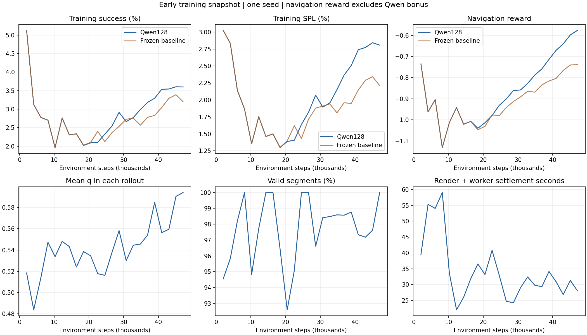

# Qwen128 / beta0.1：冻结视觉 Gibson 训练奖励

基于已验证历史图453179c，运行源码 `81fedec56b37921c350ce8064106c32788bb3e04`；独立工作树与分支 `SIGN-qwen128-reward` / `phase2/qwen128-reward-beta01`。该目录保持运行提交，资料在独立publication工作树发布，远端资料提交可比运行目录多若干资料提交。原两组coverage训练、原离线资料和已有评估目录未切换或修改。

## 最新训练对照：2026-10-31

六组训练的同预算SR/SPL、覆盖与奖励尺度、基线停止记录及可复核数据见[最新训练快照](ablations/training_20261031/README.md)。本页下方保留原beta0.1启动验收记录，运行源码81fedec；新ABC运行源码d2352f0。

## 早期进展：2026-10-29 16:01快照

**40,960步短测1507196已完成；正式长训练1507268已经在此前“通过后直接提交正式训练”的授权下，从全新初始化启动。两者是不同进程和输出目录。** 当前继续现有正式作业，本次只核验并同步代码/资料，没有再提交训练。

| 作业 | 类型 | 已完成环境步 | 输出末级目录 |
|---|---|---:|---|
| 1507196 | 工程短测，Exit0 | 40,960（Qwen部分） | short_qwen_40960 |
| 1507268 | 正式长训练，R | **47,104 / 23更新** | train_personal_8env |

快照最后事件2026-10-29T16:00:29+08:00，55项scalar有限，1399/1431片段有效（97.76%），新增bonus累计10.365287，q范围0.1150–0.8764／均值0.5453。原nav_rewards和masks未改变、ID唯一、公式及未折扣总量核对通过；25段高度变化/7段网格边缘超容差跳过奖励，原因原样保留。

| 相同47,104步的训练滑窗末点 | Qwen128 | 冻结视觉基线 |
|---|---:|---:|
| SR | 3.599% | 3.200% |
| SPL | 2.807% | 2.212% |
| 原导航reward | -0.576386 | -0.738183 |

这些是原训练episode滑窗末点，不是独立验证结果；当前仅约4.7万步，不能由这几个早期点认定Qwen提高成功率。初期数值略高只作为记录。q均值也不能直接当学习进步。

每2048动作的中位墙钟64.26秒，最近10轮中位63.79秒；当前没有正式训练checkpoint是正常保存节奏：每250更新即512,000步首次落盘，尚未到达。短测checkpoint已单独保存。4.608M/8.192M未来评估仍分别为1507270/1507272（batch_gpux，等待依赖），没有新验证成绩。

[完整机器可读快照](evidence/progress_20261029T160130/progress.json) · [Qwen全部scalar CSV](evidence/progress_20261029T160130/qwen_scalars.csv) · [同阶段基线CSV](evidence/progress_20261029T160130/baseline_matched_scalars.csv) · [实际配置](evidence/progress_20261029T160130/effective_config.yaml) · [逐段概率/logits/窗口](evidence/progress_20261029T160130/segments.jsonl)。原始TensorBoard事件前缀、rollout审计和源文件SHA也保存在该快照目录；全部是只读有限字节快照，未重跑导航评估。



## 正式运行

- 训练：**1507268.stdct-mgmt-02**，个人auto / 1A40 / 36CPU / 240GB / 168h，300M算法上限。已从全新初始化运行；不加载短测权重，也不把168h当成300M完成承诺。
- 8环境×256步、seed100/PYTHONHASHSEED0；只加载冻结公开visual_encoder，其余原初始化。原PPO、MRQ、RandomShift、Qc及评估设置保留。
- Qwen3.5-2B 独立qwen35常驻进程、一次加载FP32，独立单图batch≤8。使用既有class_probabilities，A32/B33/C34、T1，q=.5p_medium+p_high。
- 每环境rollout第128/256动作或真实terminal切段，只在末步加 `0.1 * actual_segment_actions / 256 * raw_q`；不居中。真实masks/GRU不改，覆盖历史只在真实reset清空。
- 几何coverage bonus权重0；storage新增nav_rewards存原奖励，MRQ在本实验中只预测nav_rewards，GAE/PPO/critic用混合rewards。旧配置继续原MRQ行为。
- 公共几何/绘图函数沿用已验证2.5cm/3m/90°、黄历史/红当前同宽1.5pt实线、深蓝段前已见/浅蓝真正新增；prompt直接复用 [history.txt](../qwen-history-solid/prompts/history.txt)，SHA `12081a916f12d7be09cf64bfcfc390bcfcdf2508fd5eda9f195943615027c404`。
- 环境auto-reset前独立快照，以env/reset/episode/rollout/窗口/全局步核对；payload先移除再提取标量。worker异常或ID错误硬报错；几何无效记录原因、跳过bonus，不冒充q0。
- 关闭或beta0不启动worker/轨迹采集；评估及部署关闭Qwen/其轨迹采集。

实际训练命令（已执行；同输出目录不重复启动）：

```bash
cd /scratch/e1538633/liuyi/SIGN-qwen128-reward
/scratch/e1538633/liuyi/envs/sign-baseline/bin/python run_sim.py --exp-config exp_config/ppo_imagenav_gibson.yaml,policy,reward,sensors,qwen_reward --run-type train --model-dir /scratch/e1538633/liuyi/SIGN-qwen128-reward/results/qwen128_reward_20261029/train_personal_8env habitat_baselines.num_environments 8 habitat_baselines.rl.ppo.num_steps 256 habitat_baselines.rl.ddppo.pretrained_encoder True habitat_baselines.rl.ddppo.pretrained_weights ckpt/nav_model.pth habitat_baselines.rl.ddppo.train_encoder False habitat_baselines.num_checkpoints -1 habitat_baselines.checkpoint_interval 250 habitat_baselines.log_interval 10 qwen_reward.beta 0.1
```

PBS启动/评估支持在 [scripts](scripts/)，完整提交回执 [submission.json](evidence/submission.json)，实际参数与守卫见 [evidence](evidence/)。训练环境sign-baseline未升级，Qwen35独立torch2.6/transformers5.17。

## 验证结果

54项单测通过；32原轨迹全部44窗口prior/final mask和面积精确一致，墙体遮挡通过；额外8环境×6rollout/12288动作/446片段的随机reset/边界交汇/回填核对通过。真实milestone保存函数的步数/SHA及拒绝覆盖检查通过。完整 [short_validation.json](evidence/short_validation.json)。

GPU短测1507196 Exit0，含原基线8192步、beta0对照8192步、Qwen40960步/20更新、原基线复跑8192步：

| 检查 | 实际结果 |
|---|---|
| 有效片段 | 1176/1204 = 97.6744% |
| 无效几何 | 高度跨度≥0.5m：23段；超原5cm网格容差：5段，全部跳过bonus |
| q范围／均值 | 0.130278–0.869575 / 0.538305，仅描述分布，不判断收益 |
| 累计bonus | 8.88134385，每段公式及未折扣总量核对通过 |
| 冻结/数值 | 42项encoder状态与公开权重逐位相同；visual_fc从原初始化更新；模型和55项scalar有限 |
| 原奖励/真实mask | 不变；ID唯一，无重复回填 |
| batch/solo | 最大概率差9.02514e-6；排列及forward/生成首步差0 |
| 初始参数 | Qwen与beta0全部状态SHA相同；未额外初始化或加载其他导航参数 |
| 零权重训练 | 原29项训练scalar逐位相同，98项checkpoint逐位相同；仅5项Qc≤1.49e-8舍入差；未修改基线自身复跑6项Qc≤2.98e-8，源码/运算选项未变 |
| 在线真实历史 | 全短测最大段前230步；保存175步历史/63步当前段样图，位姿重放mask/统计/PNG字节完全一致 |

当前短测没有真实1000步前置历史GPU压力证据，不用短测SR或平均q声称学习收益；离线分级的人审限制继续保留。

### 实测开销

| 每2048 transition更新 | 中位墙钟秒 |
|---|---:|
| 原冻结基线 | 7.547 |
| 新分支beta0 | 7.597 |
| Qwen128 beta0.1 | 59.244 |

热身后平均每轮绘图15.236秒、worker14.090秒；增量几何9.473秒是8环境CPU累计耗时，不能直接加到墙钟。早期频繁终止带来1204/20≈60张图每轮，随episode长度变化。worker峰值9.362GiB，总GPU每5秒采样峰值24947MiB（采样值）。当前reference PyTorch Qwen内核未加装新依赖；数据只用于预算参考，不承诺全程固定速度。

## 输出、日志与图片

服务器输出 `/scratch/e1538633/liuyi/SIGN-qwen128-reward/results/qwen128_reward_20261029/train_personal_8env/`：`tb/`、`ckpts/`、`qwen/segments.jsonl`、`qwen/rollouts.jsonl`、`qwen/effective_config.yaml`、`qwen/worker_boot.json`、`qwen/samples/`。原`reward`仍是环境导航奖励，新增`learner/qwen_*`记录bonus/q分布/面积/有效率/时间/worker显存。

每段记录窗口、身份、面积、概率/logits和图片SHA；PNG与完整位姿/mask仅定期（250 rollout/最多2段）或诊断抽样，避免全量图积累。旧请求中的tmp路径为当时实际输入路径；[samples](samples/)相邻PNG是同SHA保存副本，JSON追加sample_image相对引用，不改原统计或评分。临时PNG只清理本请求产生的目录。

本地浏览器查看新TensorBoard（保留旧6006服务）：

```bash
ssh -t -o ExitOnForwardFailure=yes -o ServerAliveInterval=30 -o ServerAliveCountMax=3 \
  -L 127.0.0.1:16007:127.0.0.1:6007 e1538633@vanda.nus.edu.sg \
  'bash /scratch/e1538633/liuyi/logs/qwen128_reward_20261029/view_tensorboard.sh'
```

浏览器 `http://127.0.0.1:16007`；首次事件写入后出现曲线。

## 4.608M / 8.192M评估安排

正式每250更新保存checkpoint；两个目标额外保存独立不可变milestone_STEP.pth及真实step/SHA侧车。

| 训练步数 | CPU等待作业 | GPU评估作业 | 当前安排 |
|---|---|---|---|
| 4,608,000 | 1507269 | 1507270 | after训练开始；checkpoint核验后afterok释放 |
| 8,192,000 | 1507271 | 1507272 | 同上 |

GPU等待时不占GPU。每组原协议Gibson val4200条/14场景，确定性6环境、max500、seed100/hash0、同公开safety权重、原生SIGN evaluator；Qwen和其轨迹采集关闭。沿用三方法评估的0.1m/3m/90°被动覆盖measure、weight0，报告SR、SPL、sum新面积/sum动作及逐episode效率均值；该0.1m统计与Qwen输入0.025m明确分开。结果写 `logs/qwen128_reward_20261029/val_STEP/result.json`，未完成前不报告新成绩。

## 代码变更边界

`src/qwen_geometry.py`提取公共几何/绘图，`qwen_rollout.py`维护采集与身份账本，`qwen_reward.py`负责常驻进程客户端/渲染/奖励结算；worker复用原SingleImageJudge，不开发第二套Qwen框架。`environment.py`增加训练专用子类，`custom_rollout_storage.py`隔离原导航奖励，`algo/PPO.py`仅切换本实验MRQ奖励目标，`trainer.py`增加初始化/采集/returns前结算和milestone保存。`run_sim.py`关闭非训练入口Qwen；新增一个qwen_reward.yaml和边界测试，未改网络/冻结逻辑/原其他损失与超参数。

根四文档为服务器维护源，发布副本在 [workspace](workspace/)；WORKLOG只追加并核对既有已发布前缀。旧结果不覆盖，未上传新训练权重、场景、环境或相机原始数据。


## A/B/C beta0.03与匹配几何128对照

基于33e30d2的独立实验、冻结校准及实际作业见 [A/B/C实验记录](ablations/README.md)。原beta0.1正式训练1507268及旧coverage和评估依赖继续保留。
