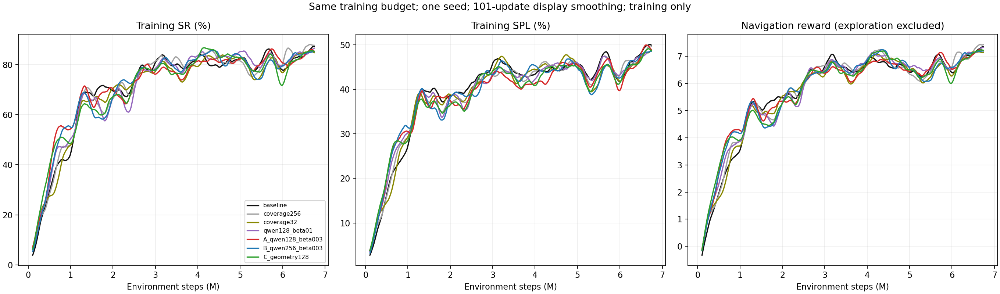

# 六组训练对照：2026-10-31固定快照

事件取样末时为新加坡时间2026-10-31 00:51–00:53，以下不是实时看板。仅汇总原训练日志与已保存权重；本次没有提交/停止训练，没有重新采样或评估。原生SR/SPL是50-update完成episode滑窗，区间均值的相邻点相互关联，不作独立统计样本。

## 各自最新进度

每轮为8环境×256动作=2048环境步。SR/SPL取各自最后100万步的滑窗均值；步数不同不能直接排名。耗时为近期3h实测中位数，节点不同，不作受控速度基准。

| 方法 | 训练作业 | 环境步 | SR | SPL | 秒/轮 |
|---|---|---:|---:|---:|---:|
| 旧覆盖256 | 1497416 | 115,169,280 | 86.84% | 51.24% | 5.29 |
| 旧覆盖32 | 1502352 | 43,018,240 | 86.18% | 48.64% | 10.46 |
| Qwen128 beta0.1 | 1507268 | 7,084,032 | 84.65% | 46.67% | 33.55 |
| A Qwen128 beta0.03 | 1507648 | 6,844,416 | 82.52% | 45.32% | 33.13 |
| B Qwen256 beta0.03 | 1507651 | 7,290,880 | 83.81% | 46.85% | 31.48 |
| C 几何128 | 1507650 | 18,020,352 | 85.25% | 49.51% | 12.20 |

## 相同训练预算比较

统一取5,844,416–6,844,416步的100万步区间，已停止基线使用相同历史区间。

| 方法 | SR | SPL | 平均碰撞/episode |
|---|---:|---:|---:|
| 冻结视觉基线 | 82.47% | 46.27% | 18.63 |
| 旧覆盖256 | 84.36% | 46.44% | 19.74 |
| 旧覆盖32 | 82.38% | 45.60% | 19.55 |
| Qwen128 beta0.1 | 83.15% | 46.05% | 18.83 |
| A Qwen128 beta0.03 | 82.52% | 45.32% | 21.40 |
| B Qwen256 beta0.03 | 82.87% | 46.07% | 18.39 |
| C 几何128 | 80.68% | 45.46% | 18.99 |

在此窗口Qwen beta0.1/B略好于旧覆盖32，三Qwen均未超过旧覆盖256。改用同结束步的最近300万步，beta0.1 SR83.02%高于旧256的82.26%，SPL45.11%仍低于45.40%；最近500万步则为79.58%/43.49%对79.88%/43.65%。结论对窗口敏感，当前没有稳定全面收益证据，不能按单个末点或平均q判定算法优劣。

旧三方法共同38.018–43.018M的5M窗口，基线/256/32 SR86.24/85.47/84.96%，SPL51.05/47.49/47.62%。它们与18.944M固定checkpoint的val结果属于不同阶段与统计口径；本页只讨论训练。



图仅为展示额外采用101-update平滑；表格来自未额外平滑的原生日志。[完整统计](readout.json)保存各组末点/近期均值、共同区间与原始快照SHA，[1/2/3/5M复核](comparison_followup.json)保存窗口与点数。

## 几何128、覆盖与奖励尺度

C是A的几何对照：相同2.5cm/3m/90°采集、episode历史和几何有效性，128步/真实terminal切段，PPO仍256步。A段末bonus=.03*(L/256)*raw_q；C为alpha*new_area_m2/256，无Qwen、topdown渲染或伪概率。alpha=.2927574680399425来自[既有冻结校准](../calibration/calibration.json)，仅保证原校准集总量匹配，不保证训练中持续匹配。

共同5.844–6.844M的A/B/C有效动作覆盖效率为0.15941/0.16081/0.16514m²/动作，C面积略高但SR较低。每轮bonus为0.13473/0.13992/0.35013，C约为A的2.60倍；未重拟合alpha。原reward仍是导航奖励，bonus独立记录。

旧覆盖的0.1m全动作统计，与新组0.025m且仅纳入几何有效段的面积统计不直接排名。基线训练本身没有面积日志；这些数据不能证明新增奖励已减少冗余搜索。

新四组各自近1M的有效段约92.7–93.2%，低于短测约98%；主要为episode高度跨度≥0.5m，少量距navmesh超过5cm，按既有规则跳过bonus。A/B有效片段平均q约0.625/0.653，仅描述裁判输出，不作效果指标。共同段统计、valid动作数和面积在JSON中分开保留。

## 冻结基线停止记录

基线1496716于2026-10-28 20:28:36停止，最终训练步74,653,696；控制台末步74,649,600；最后已保存、可用于评估的checkpoint为74,240,000步，三者不同。

| 训练统计 | SR | SPL |
|---|---:|---:|
| 最后一个原生滑窗点 | 87.81% | 55.13% |
| 最后100万步滑窗均值 | 87.87% | 54.82% |
| 最后500万步滑窗均值 | 89.42% | 55.66% |

这不是额外的完整训练集离线评估；公开完整checkpoint的4200条val SR86.00%/SPL53.01%是另一个结果。快速索引见[STATUS](../../workspace/STATUS.md#gibson-reference)。

## 完整性与复核

六个训练作业在快照时均R，所有scalar历史有限；最近稳定编号checkpoint均全有限，42项encoder状态逐位匹配公开权重。四新组已完成rollout编号连续、nav_rewards和真实masks不变，混合奖励守恒误差小于5.1e-5；旧coverage bonus守恒误差小于1.8e-8。[权重检查](evidence/checkpoint_check.json)记录实际checkpoint步与SHA，不用事件末步代替权重步。

[data](data/)保存七组所选scalar CSV及四组固定前缀rollout审计的确定性gzip；[inputs.json](inputs.json)记录原路径、原字节数与SHA。完整TensorBoard二进制事件、模型/场景/环境保留在服务器，没有重复上传。JSON中的绝对路径属于服务器来源证据，不代表仓库内存在该文件。

在已安装TensorBoard/numpy/matplotlib的服务器环境，从liuyi根执行原只读工具（每次新建快照，不提交作业）：

```bash
envs/sign-baseline/bin/python logs/training_readout_20261031/readout.py
```

从本仓库根离线核验已发布gzip SHA、56项窗口均值、导航奖励/mask审计和相对链接，无需模型或GPU：

```bash
python3 docs/experiments/qwen128-reward/ablations/training_20261031/scripts/publish_readout.py --tree . --check-only
```

[operations](operations/)保留10月30日TensorBoard启动/复用/会话清理脚本及四项已完成集成检查，原三组logdir/6006不变。线上命令仍见[RUNBOOK](../../workspace/RUNBOOK.md)，脚本副本用于复现和审阅；本次未启动/停止网页服务。

本次仅资料发布，运行源码保持原提交；没有重跑单测/GPU训练，资料SHA、解压、指标复算、WORKLOG追加关系及链接另行检查。评估作业沿用既有安排，本页不复核或报告新val结果。[A/B/C设置与提交回执](../README.md)、[根四文档快照](../../workspace/)保留进一步索引。
