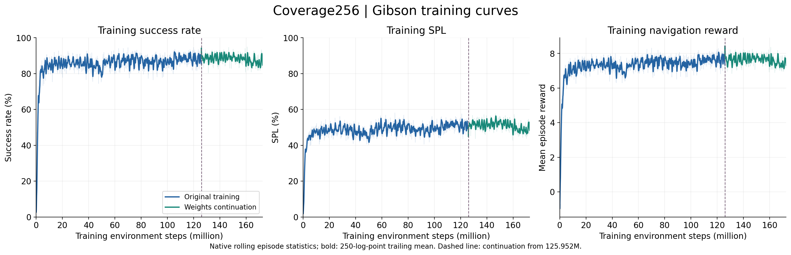
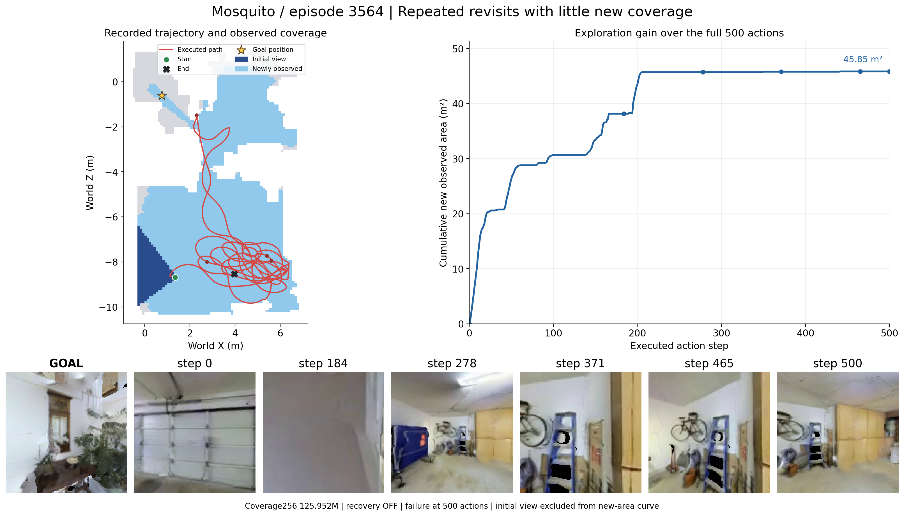
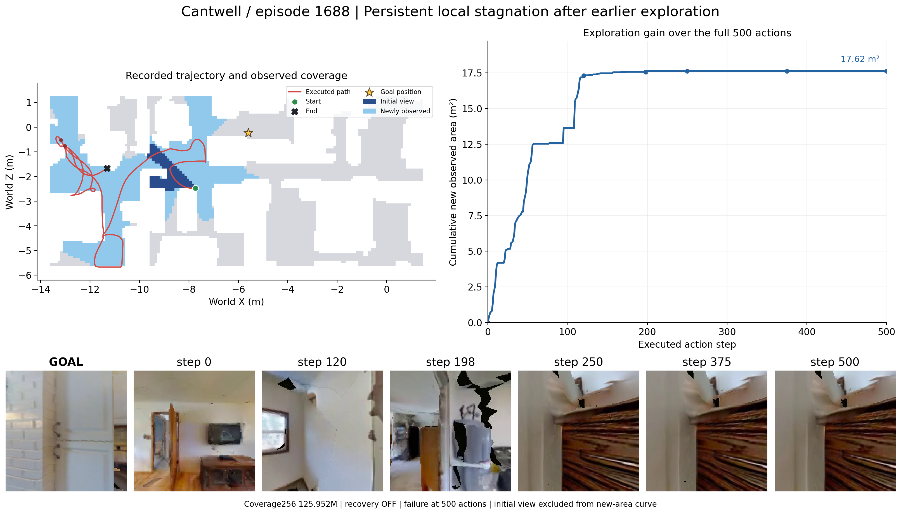
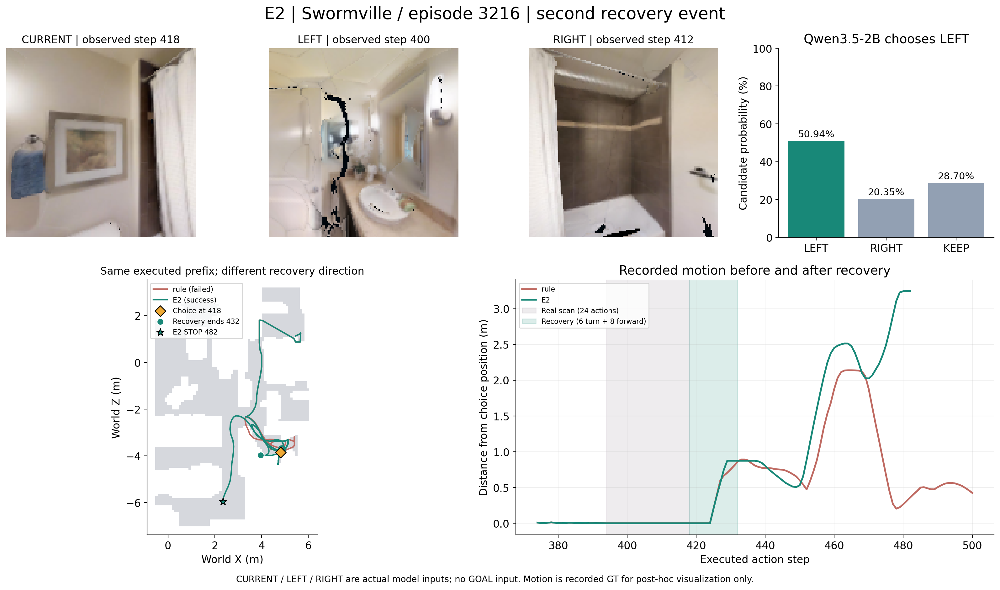

# 报告与 PPT 配图：第一版

2026-11-09。全部从已有实验记录在登录节点以 CPU 导出；没有重跑导航、Qwen 或 PBS 作业。图内用英文方便直接放入英文 PPT，下方提供中文讲解与数据口径。

优先用 **PNG** 插入 PPT、用 **PDF** 放进报告。训练图另有 SVG；每个案例也拆出了单独的目标图、带 step 标注的 RGB、轨迹图和 CSV，便于重新排版。这里没有对原始 RGB 进行生成式修改。

## Public SIGN 成功演示视频（新增）

[24 秒、720p H.264 MP4](demo_public_sign/public_sign_success_720p.mp4) · [目标图与 4 张关键帧](demo_public_sign/README.md) · [metadata](demo_public_sign/metadata.json)

公开完整 SIGN 权重，**Habitat-GS / interior_0651_841463 / episode 0**，50 步成功，SPL 0.6143；2.5× 仿真时间、末步 STOP 停留 4 秒。来源是已有 2026-10-28 录像，本次仅 CPU 整理；不是 Gibson，也不是 Coverage256 策略。原输入 128×128 放大展示，实际路径长度未保存。详情和来源 SHA 见目录说明。

## 1. Coverage256 的训练 SR、SPL、reward



[PNG](training/coverage256_training_curves.png) · [PDF](training/coverage256_training_curves.pdf) · [SVG](training/coverage256_training_curves.svg) · [全部原始数据 CSV](training/coverage256_training_raw.csv) · [数据来源与口径](training/metadata.json)

也可单独取 [SR](training/sr.png)、[SPL](training/spl.png)、[navigation reward](training/navigation_reward.png)，对应同名 PDF。

- 覆盖从首次记录 **2,048 步到 172,599,296 步**；原训练 61,609 个日志点、续训 22,777 个日志点。
- 这是训练期间完成 episode 的滚动统计，不是对训练集重新执行一次固定评估，也不是验证集 SR/SPL。原生统计窗口配置为 50 个 PPO update，8 环境 × 256 步/update。
- 淡线为原生日志抽样显示，粗线为额外 250 日志点的尾随均值（约 0.512M 环境步）。CSV 保留全部原始点，不做额外平滑。
- 虚线 **125.952M** 表示从已保存权重续跑，优化器及 episode 当时重新初始化；两段单独绘制和平滑。原训练实际还有少量日志到 126.175232M，CSV 保留；主图在恢复权重处截断这段，避免把回退后重走的训练步数接成一条连续历史。
- **reward 是环境返回的原导航奖励，不包含 coverage bonus。**

可直接用于图注：*Coverage256 training statistics on Gibson. The dashed line marks weights continuation from 125.952M steps. Bold lines are trailing means of the logged statistics.*

## 2. 两个 recovery-off 的 500-step 真实失败

都使用 **Coverage256 125.952M checkpoint（原 ckpt.245）**，未启用恢复控制；原生评估为 seed100/hash0、max500。这些轨迹来自已完成的独立诊断记录，原目标图与位姿轨迹哈希核对一致。选例用于展示行为，不用两个案例估计全体失败占比。

### A. Mosquito / episode 3564：反复返回，新增覆盖接近平台



[整图 PDF](failures/Mosquito_3564/case_overview.pdf) · [单独轨迹/覆盖图](failures/Mosquito_3564/trajectory_coverage.png) · [目标与 6 张 RGB](failures/Mosquito_3564/rgb_storyboard.png) · [覆盖曲线](failures/Mosquito_3564/new_coverage_curve.png) · [逐步数据 CSV](failures/Mosquito_3564/trajectory_and_coverage.csv) · [metadata](failures/Mosquito_3564/metadata.json)

`scene_id = data/scene_datasets/gibson/Mosquito.glb`，`episode_id = 3564`。

全程移动约 **82.69 m**，新增观测面积 **45.85 m²**。第 250–500 步仍移动 **37.99 m**，新增仅 **0.12 m²**；图中可见多次回到车库区域，最终未到达目标。它展示的是“持续移动不一定意味着有效扩展”，不把每一次必要返回自动判为无效探索。

RGB 步数：**0、184、278、371、465、500**。单张 `rgb_step_*.png` 保留解码像素；`labelled_step_*.png` 带场景、episode 与 step 标题。

### B. Cantwell / episode 1688：探索后持续局部受阻



[整图 PDF](failures/Cantwell_1688/case_overview.pdf) · [单独轨迹/覆盖图](failures/Cantwell_1688/trajectory_coverage.png) · [目标与 6 张 RGB](failures/Cantwell_1688/rgb_storyboard.png) · [覆盖曲线](failures/Cantwell_1688/new_coverage_curve.png) · [逐步数据 CSV](failures/Cantwell_1688/trajectory_and_coverage.csv) · [metadata](failures/Cantwell_1688/metadata.json)

`scene_id = data/scene_datasets/gibson/Cantwell.glb`，`episode_id = 1688`。

前段曾移动并扩展覆盖，最终新增 **17.62 m²**。第 250–500 步记录位移为 **0 m**、新增面积为 **0 m²**；后面三张 RGB 持续贴近木柜。该例用于讲局部停滞/受阻，应与重复搜索分开。

RGB 步数：**0、120、198、250、375、500**。两个案例均以 500 步到限结束，未调用 STOP，success=0。

### 地图和面积口径

灰色是保存的 GT 可通行栅格；深蓝是初始视野；浅蓝是此后真正新增的观测区域；红色是实际轨迹。面积曲线从 0 开始，**扣除了初始视野**。所有逐步值直接取原记录的 `coverage_new_area_m2`，已核对增量累加及最终 seen-mask 差集面积。

使用原评估的 **0.1 m/像素、3 m、90°** 二维 XZ 视域覆盖代理，没有换成后续 Qwen 奖励的 0.025 m 口径。地图仅用于事后展示，不是部署策略输入。两例保存的初始/最终地图一致；Mosquito 高度变化约 0.297 m，仍按原 XZ 投影展示，不声称这是精确三维表面积。绘图只裁掉空白边缘，世界坐标和比例保持一致。

RGB 来自原诊断 H264 视频的观测区域，原视频曾压缩/缩小至 128×128；目标 PNG 单独保留。像素模糊、缺面和黑色区域来自原记录，不做美化补全。

## 3. E2：Qwen 真正改变方向的一次配对恢复



[整图 PDF](recovery/E2_Swormville_3216/E2_recovery_overview.pdf) · [仅输入与概率](recovery/E2_Swormville_3216/E2_inputs_probabilities.png) · [实际动作图](recovery/E2_Swormville_3216/actual_recovery_commands.png) · [前后运动曲线](recovery/E2_Swormville_3216/before_after_motion.png) · [配对轨迹](recovery/E2_Swormville_3216/paired_trajectory.png)

`scene_id = data/scene_datasets/gibson/Swormville.glb`，`episode_id = 3216`，第二次事件 `event_0000101`。

| 内容 | 实际记录 |
|---|---|
| 触发 | 观测 step394 后开始真实扫描 |
| LEFT / RIGHT / CURRENT | 分别来自 step400 / 412 / 418 |
| Qwen 输入 | CURRENT、LEFT、RIGHT，**E2 没有 GOAL 图输入** |
| 候选概率 | LEFT **50.9446%**，RIGHT **20.3526%**，KEEP **28.7028%** |
| Qwen 选择 | LEFT；匹配规则在第 2 次恢复选择 RIGHT |
| 真实执行 | 动作419–424：线速度0、角速度+15°/s；425–432：线速度0.20m/s、角速度0；每动作1秒 |
| 之后 | 交还 SIGN；E2 在 step482 成功停止，SPL **0.308381**；规则至500步失败 |

输入图片文件 SHA 已核对；与规则组到观测 step418 为止的动作、位姿**逐值相同**，三张候选图也相同。恢复执行记录与选中的14步计划相同。它是一个有真实选向差异的配对救回案例；不据单例推断模型的内部理由或总体优势。

概率是原 FP32 Qwen3.5-2B 的 **left/right/keep 首 token logits 做 T=1 候选 softmax**，不是脱困成功率，不是模型生成的数字。

**记录边界：E2 未保存恢复后的连续 RGB。** 因此后续行为使用原动作/位姿和已保存的 RGB 变化标量展示，未重渲染、未拿其他方法画面代替。`goal_for_reader_only.png` 是给读者看的导航目标，未进入 E2 请求；该目录的 CURRENT/LEFT/RIGHT 是真实模型输入。

数据：[概率/logits CSV](recovery/E2_Swormville_3216/candidate_probabilities.csv)、[实际扫描与恢复动作 CSV](recovery/E2_Swormville_3216/actual_intervention_actions.csv)、[E2 全轨迹/动作 CSV](recovery/E2_Swormville_3216/E2_actual_trajectory_actions.csv)、[规则轨迹/动作 CSV](recovery/E2_Swormville_3216/rule_actual_trajectory_actions.csv)、[原 E2 事件](recovery/E2_Swormville_3216/original_E2_event.json)、[原规则事件](recovery/E2_Swormville_3216/original_rule_event.json)、[观测后果记录](recovery/E2_Swormville_3216/recorded_outcomes.json)、[metadata](recovery/E2_Swormville_3216/metadata.json)。

## 复现与来源

- [案例与原始来源 SHA 清单](case_manifest.json)、[训练日志 SHA](training/metadata.json)、[导出核验](validation.json)。原大视频、TensorBoard 二进制、checkpoint、场景不纳入此配图目录。
- 导出脚本：[export_cases.py](scripts/export_cases.py)、[export_training.py](scripts/export_training.py)。仅用 numpy、matplotlib、Pillow、imageio/ffmpeg、TensorBoard 解析器，无模拟器或模型推理。
- 固定导航权重：125,952,000 steps，SHA256 `988c9ecc5b0c704e9a4780f636739aec17cbd323d613f0fbdde4699296886c2c`。E2 源码 `e9396ac0c989ea515edcbd7f8d0085be38f818e7`；初始失败诊断使用原 `SIGN-coverage-eval` 记录。

在服务器从 liuyi 根目录运行（**只作复现说明，选择新输出目录**）：

```bash
OMP_NUM_THREADS=1 OPENBLAS_NUM_THREADS=1 MKL_NUM_THREADS=1 \
  envs/sign-baseline/bin/python export_cases.py \
  --workspace /scratch/e1538633/liuyi --out /absolute/new_figure_directory

OMP_NUM_THREADS=1 OPENBLAS_NUM_THREADS=1 MKL_NUM_THREADS=1 \
  envs/sign-baseline/bin/python export_training.py \
  --workspace /scratch/e1538633/liuyi --out /absolute/new_figure_directory
```

`export_*.py` 请换成下载后的脚本实际路径。正常浏览图片/CSV 不需要服务器环境。当前配图适合作为首版，后续可根据 PPT 页面比例裁排，并保留同一来源与数字。
