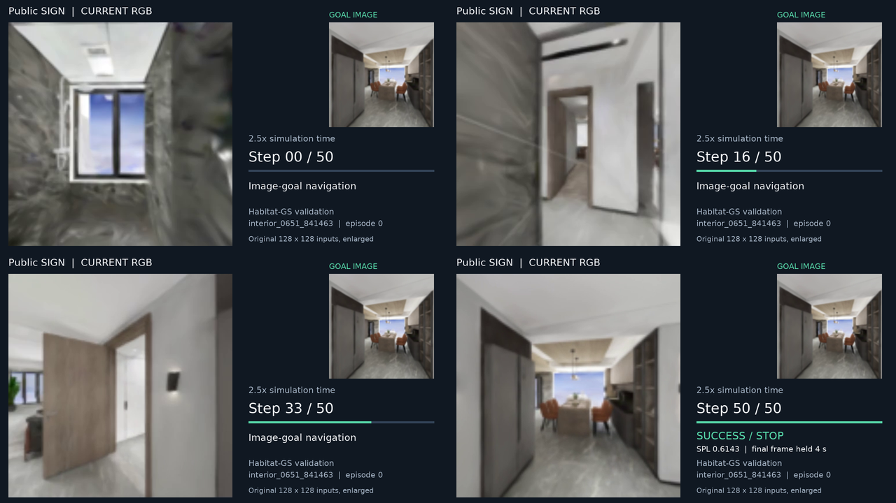

# Public SIGN：成功 ImageNav 演示

[下载 24 秒 MP4](public_sign_success_720p.mp4) · [目标图](goal.png) · [4 帧总览](keyframes_overview.png) · [metadata](metadata.json)

**使用作者公开的完整 SIGN checkpoint；场景来自 Habitat-GS，不是 Gibson。** 这是 2026-10-28 已保存的确定性成功示例，本次仅在登录节点用 CPU 裁图、排版和转码，没有重新训练、回放或运行评估。它不是此前完整评估的原始录像，也不用于估计总体成功率。



## 可直接放入 PPT

- `public_sign_success_720p.mp4`：H.264 / yuv420p，1280×720，16:9，30 fps，无音轨，总长 **24 秒**。当前 RGB 为主画面，右上角固定目标图，标注 step；保留全部 0–50 步观测，不做生成式补帧。
- 前 20 秒以 **2.5× 仿真时间**播放：每动作对应原仿真 1 秒，每个状态显示 0.4 秒。最后 **4 秒**停留在真实 step 50 的成功 STOP 画面；最后一帧不是用目标图替换的。
- `goal.png` 是固定目标图；`keyframe_step_000/016/033/050.png` 是四张带 step、目标图和场景标记的 720p 关键帧。若需自行排版，使用对应的 `rgb_step_*.png`。
- 原策略 RGB 与目标图均为 **128×128**；已有录像将其放大为 384×384。本次从该有损录像裁取，720p 是展示画布分辨率，不是新的传感器分辨率；图像没有增强或重绘。原录像中的碰撞边框若出现则保留。

建议图注：*Public SIGN checkpoint performing image-goal navigation in Habitat-GS (episode 0, 50 actions, success = 1, SPL = 0.6143). Playback: 2.5× simulation time; final STOP held for four seconds.*

## Episode 与 checkpoint

|字段|原始记录|
|---|---|
|Scene|`interior_0651_841463`|
|Episode ID|`0`|
|数据划分|Habitat-GS / val|
|Steps / 最大步数|50 / 500|
|Success|1.0|
|SPL|0.6143305897712708|
|最终目标距离|0.3710636496543884 m|
|任务文件中的初始最短路径长度|4.642218112945557 m|
|实际累计路径长度|未保存；metadata 中为 null，不从 SPL 倒推|
|碰撞次数|1|
|导航权重|公开 `ckpt/nav_model.pth`，SHA256 `03fa71b514c8ee2fa272d6276499d51313a43b7d71bb31181c0150cc7c050d1a`|
|安全权重|公开 `ckpt/safety_model.pth`，SHA256 `b84d291e84216defb730d07d03cb6f25e3555ae447eb1e69057f3427b3c7ec31`|
|录制源提交|`95eef9bf497bc1d010c7a4b35030fdce4123dce7`|
|原作业|`1503625.stdct-mgmt-02`|
|Seed / PYTHONHASHSEED|100 / 0|

原生 Success 要求 STOP 且目标距离小于 1 m，本例 success=1、step 50 task-ended，因此保留并标注最终 STOP。原录制器没有保存动作向量或逐步位姿；不额外声称有最后一条速度命令或实际路径长度记录。最短路径长度直接取原任务的 `info.geodesic_distance`，不能当实际行驶距离。

## 来源、核验与 CPU 复现

- [原始短录像](original_recording.mp4)、[原 manifest](source_manifest.json)、[原任务条目](source_episode.json)、[来源路径/SHA](source_provenance.json) 保留可追溯性。
- [原录制器快照](original_record.py) 仅作历史证据，**不用运行**。它确认 RGB/goal 所在矩形、每动作一帧、51 个观测帧和末尾 20 个停留帧。本次展示不依赖模型或模拟器。
- [frame_mapping.csv](frame_mapping.csv) 保存每个 step 对应的原帧、输出帧区间和时间。[validation.json](validation.json) 保存完整 720 帧解码、编码信息、终帧停留和来源 SHA 检查。
- [export_demo.py](export_demo.py) 可从此目录已有素材重新导出，依赖 numpy、Pillow、Matplotlib（仅字体）、imageio/imageio-ffmpeg 及 ffprobe。选择新输出目录，避免覆盖旧结果。

服务器命令（仅供复现；本次已执行等价 CPU 导出）：

```bash
cd /scratch/e1538633/liuyi
OMP_NUM_THREADS=1 OPENBLAS_NUM_THREADS=1 MKL_NUM_THREADS=1 \
  nice -n 10 envs/sign-baseline/bin/python \
  SIGN-qwen-intervention-memory/docs/experiments/report-figures-20261109/demo_public_sign/export_demo.py \
  --source-dir SIGN-qwen-intervention-memory/docs/experiments/report-figures-20261109/demo_public_sign \
  --out /scratch/e1538633/liuyi/logs/public_sign_demo_new
```

Gibson 的公开权重现有 pilot 仅保存稀疏 RGB，未用于拼接这段连续演示。若后续指定 Gibson，可补回放 `Edgemere / episode 200 / C01` 的 35 步成功记录；这次没有启动该回放。
